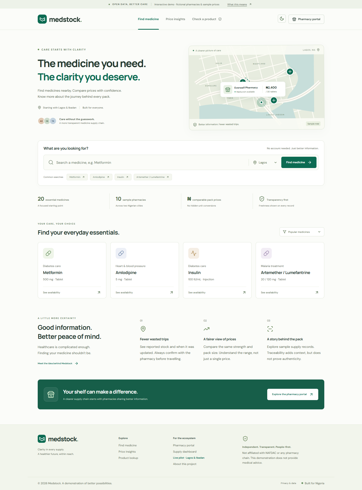
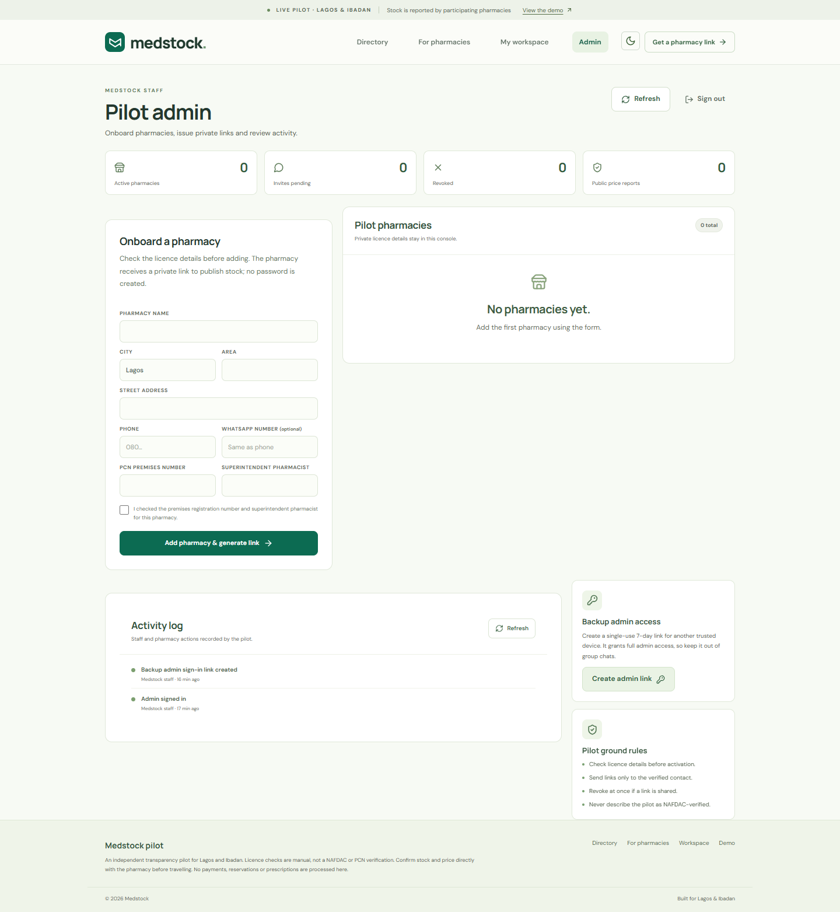

# Medstock

**Know what is on the shelf before you travel.**

Medstock is an independent medical-supply transparency project for Lagos and Ibadan. It combines an interactive public demo with a working pharmacy pilot: invited pharmacies publish the medicines they have and the price per pack, while patients see how recently each listing was confirmed.

[Live demo](https://medstock-transparency.netlify.app/) · [Pilot directory](https://medstock-transparency.netlify.app/pilot)



> **What this is — and is not**
>
> Listings are self-reported. Each pilot pharmacy is manually checked against its premises registration number and superintendent pharmacist before activation. Medstock is not affiliated with NAFDAC, the Pharmacy Council of Nigeria, or any pharmacy chain. A listing is not proof of authenticity, a regulator verification, or medical advice. The public demo uses fictional data throughout.

## Two experiences

| Experience | Path | Data |
| --- | --- | --- |
| Interactive demo | `/` | Fictional medicines, pharmacies, prices and batch records bundled at build time |
| Pharmacy pilot | `/pilot` | Self-reported stock from invited pharmacies; stored in Netlify Blobs |

### Public demo

- 20-medicine catalogue and 10 clearly labelled fictional pharmacies across Lagos and Ibadan.
- Search by medicine, compare pack prices, filter by stock/freshness, and switch between list and map views.
- A sample price index with median, lowest and highest prices, outlier flags and an illustrative 12-week trend.
- A fictional batch lookup that explains supply records without claiming product authenticity.
- A browser-only pharmacy workspace and simulated oversight dashboard.
- Responsive layout, light and dark themes, keyboard-visible focus states and WCAG contrast checks.

### Pharmacy pilot

- **Directory** — only active pharmacies with at least one priced item are listed. Every item shows when it was confirmed; anything older than 24 hours is marked “Call to confirm.”
- **Pharmacy workspace** — a passwordless magic link opens a private workspace where a pharmacy can list up to 20 medicines, set the price per pack, update quantity and confirm stock.
- **Admin console** — manually record a pharmacy after checking its premises registration and superintendent, generate or rotate its private link, revoke or delete access, create backup admin links, and review the audit log.
- **No accounts, no passwords, no public signup** — access is entirely through private links sent to the verified contact.



## How the pilot works

1. An operator checks the pharmacy’s premises registration number and superintendent pharmacist, then adds the pharmacy in the admin console.
2. The console generates a private, reusable pharmacy link, valid for 30 days, to send through WhatsApp.
3. The pharmacy opens the link and publishes up to 20 medicines with a price per pack. Saving the list confirms every listed item as of that moment.
4. The public directory shows the pharmacy once it is active and has at least one priced item. Prices and quantities are visible to everyone; licence details are not.
5. Rotating or revoking a link invalidates existing pharmacy sessions. Admin and pharmacy actions are written to an audit log.
6. Admin links are single-use and valid for 7 days. Admin sessions last 7 days; pharmacy sessions last 30 days.

## Architecture

```text
Patient / pharmacy / admin browser
              │
              ▼
   React 19 single-page apps
   /  demo        /pilot  directory, join, workspace, admin
              │
              ▼
   Netlify Functions v2 (ESM)
   /api/pilot/*        /api/admin/*
              │
              ▼
   Netlify Blobs — store: medstock-pilot
```

| Layer | Technology |
| --- | --- |
| UI | React 19, Vite 6, hand-written CSS, lucide-react |
| Maps | Leaflet with OpenStreetMap tiles |
| API | Netlify Functions v2 (`export default async (req) => Response`) |
| Storage | Netlify Blobs (`@netlify/blobs`), strong consistency |
| Tests | Node’s built-in test runner (`node --test`) |
| Hosting | Netlify static hosting + Functions |

### API routes

| Method | Route | Access | Purpose |
| --- | --- | --- | --- |
| `GET` | `/api/pilot/public` | Public | Active pharmacies with at least one priced item |
| `GET` | `/api/pilot/invite?token=…` | Invite holder | Preview a pharmacy invite |
| `POST` | `/api/pilot/accept` | Invite holder | Open a workspace and set a session |
| `GET` | `/api/pilot/session` | Session | Return the current role or workspace |
| `DELETE` | `/api/pilot/session` | Session | Sign out |
| `GET` | `/api/pilot/inventory` | Pharmacy session | Read the workspace inventory |
| `PUT` | `/api/pilot/inventory` | Pharmacy session | Validate and save up to 20 inventory records |
| `POST` | `/api/admin/login` | Admin invite | Consume a single-use admin link |
| `GET` | `/api/admin/pharmacies` | Admin | List pharmacies and pilot stats |
| `POST` | `/api/admin/pharmacies` | Admin | Create a pharmacy after a manual licence check |
| `PATCH` | `/api/admin/pharmacies` | Admin | Issue a new link, revoke, or delete a pharmacy |
| `POST` | `/api/admin/invite` | Admin | Create a backup single-use admin link |
| `GET` | `/api/admin/audit` | Admin | Recent audit entries |

### Stored data

All pilot data lives in the `medstock-pilot` Blobs store. Raw tokens are never stored — only SHA-256 hashes.

| Key | Contents | Lifetime |
| --- | --- | --- |
| `pharmacies/{id}` | Profile, licence details, status, inventory | Until deleted |
| `invites/{tokenHash}` | Pharmacy invite → pharmacy ID | 30 days; removed on rotate/revoke |
| `admin-invites/{tokenHash}` | Admin invite | 7 days; consumed on first sign-in |
| `sessions/{id}` | Role, pharmacy ID, session version | 30 days pharmacy / 7 days admin |
| `audit/{timestamp}-{random}` | Actor, action, target and summary | Append-only from the app’s perspective |

The public payload returns pharmacy name, area, city, address, phone/WhatsApp, the last licence-check date and priced inventory. Licence numbers and superintendent names are only returned to the admin console. The pharmacy workspace receives neither.

### Security and privacy

- 32-byte base64url access tokens, validated by format and hashed before storage.
- Sessions use an `HttpOnly`, `SameSite=Lax` cookie with `Secure` set on HTTPS.
- Rotating or revoking a pharmacy link increments its `sessionVersion`, invalidating older sessions.
- Mutating API routes require a same-origin request and a JSON body; request bodies are capped at 20 KB.
- Inputs are validated server-side: Lagos or Ibadan only, valid phone numbers, required licence details, whole-number quantities from 0–100,000, and pack prices from ₦0.01–₦1,000,000.
- Rate limits are applied in memory per IP and per function instance. This is suitable for a small pilot, not a hard global limit.
- Security headers, including CSP, `X-Frame-Options: DENY`, `nosniff` and a strict referrer policy, are defined in `netlify.toml`.
- No patient accounts, medical histories, prescriptions, payments or patient data are collected.
- No third-party analytics or advertising trackers are bundled. Netlify serves the site, Google Fonts supplies typography, and OpenStreetMap serves map tiles; each receives normal technical request data.

## Repository layout

```text
.
├── index.html                 # demo entry
├── pilot.html                 # pilot entry
├── src/
│   ├── App.jsx                # interactive demo
│   ├── data.js                # fictional medicines, pharmacies, batches
│   ├── lib.js                 # demo helpers
│   ├── styles.css
│   └── pilot/                 # directory, join, workspace, admin console
├── netlify/
│   └── functions/
│       ├── _lib/              # crypto, validation, Blobs store, HTTP helpers
│       └── *.mjs              # API endpoints
├── public/                    # favicon, theme bootstrap, service worker
├── database/schema.sql        # proposed relational model; not used at runtime
├── tests/                     # unit tests
├── netlify.toml
└── vite.config.js
```

`database/schema.sql` is a reference design for a broader relational model. The deployed pilot deliberately uses Netlify Functions and Blobs so it can run on the free Netlify plan without a managed database.

## Local development

Requires Node.js 20+ and npm. The Netlify CLI is needed for the pilot APIs.

Install dependencies:

```bash
npm install
```

### Demo only

```bash
npm run dev
```

Open `http://localhost:5173`. This runs Vite only; pilot API calls will fail in this mode.

### Full pilot, including Functions and Blobs

```bash
npm run build
npx netlify dev --offline --dir dist --framework "#static" --port 8899
```

Open `http://localhost:8899`. This serves the built static files, the Netlify Functions and a local Blobs emulation without touching production data. Link the folder to a Netlify site once with `npx netlify link` if the CLI asks for a site. Serving the built output avoids a Vite proxy issue that can deliver module scripts with the wrong MIME type.

### Provisioning an admin link

There is no public admin signup. An admin invite is a 43-character token whose SHA-256 hash is stored as `admin-invites/{hash}` with `{ createdAt, expiresAt }`. Opening `/pilot.html#/admin?token=…` consumes it once. After signing in, the **Backup admin access** panel creates additional single-use links. Keep admin links out of source control and public chats.

## Tests

```bash
npm test
```

The 22 unit tests run with Node’s built-in test runner and cover token generation and hashing, phone normalisation, pharmacy and inventory validation, confirmation timestamps, payload redaction, cookie flags, secure-request detection and rate limiting. They require no network or Blobs access.

Browser and accessibility checks were run separately with Playwright and axe-core during development; those local QA scripts are not part of the deployed application.

## Deployment

The project is configured for Netlify in `netlify.toml`:

- build command: `npm run build`
- publish directory: `dist`
- functions directory: `netlify/functions`
- `/pilot` rewrites to `pilot.html`
- remaining routes fall back to `index.html`

Connect the repository to Netlify, or deploy from a linked CLI session:

```bash
npm ci
npm run build
npx netlify deploy --prod --dir dist
```

Blobs is bound automatically on Netlify, so no environment variables or database credentials are required. After the first production deploy, provision the first admin invite directly in the `medstock-pilot` Blobs store as described above.

## Pilot limits

- Licence checks are manual. There is no NAFDAC, PCN or other regulator API integration.
- Medstock does not verify that a physical medicine is genuine, and a batch record is not an authenticity certificate.
- The catalogue is fixed at 20 essential medicines, and the pilot covers Lagos and Ibadan only.
- Invitations are shared manually through WhatsApp; there is no email or SMS provider.
- There are no payments, orders, reservations or prescriptions. Stock is not held.
- Rate limiting is per function instance rather than globally shared.
- Access roles are limited to pharmacy and admin.

## Disclaimer

Medstock is an independent demonstration and pilot. It is not a pharmacy, regulator, medical service or authenticity-verification service. Always confirm stock and price directly with a licensed pharmacy, and consult a qualified healthcare professional before starting, stopping or substituting any medicine.

## License

Released under the [MIT License](LICENSE). Copyright (c) 2026 Buggydemon.
